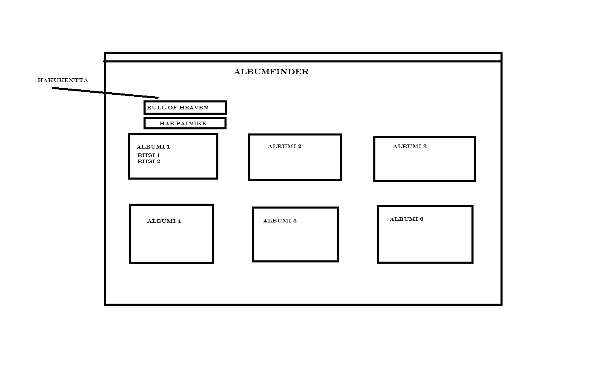
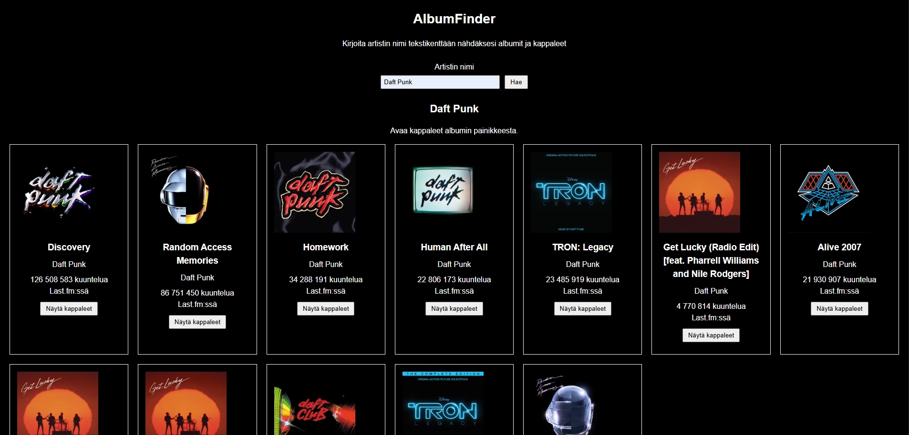
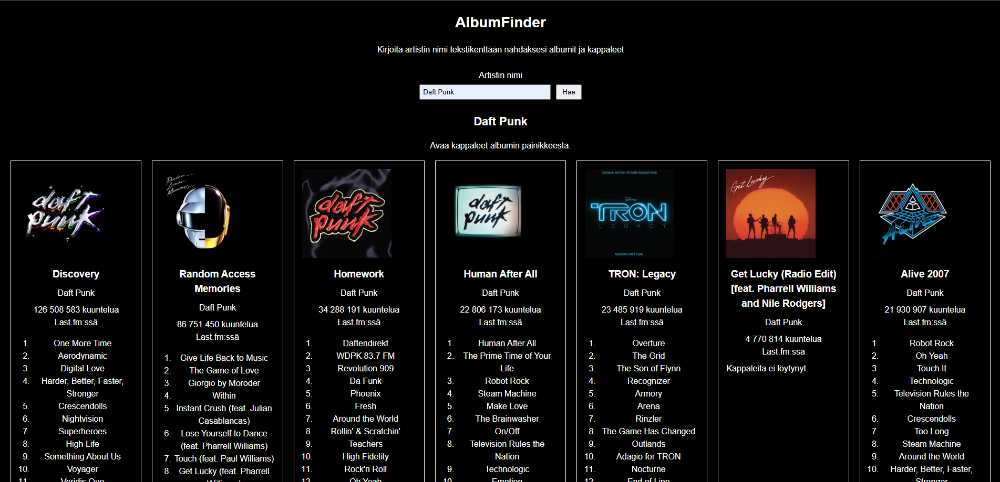

# AlbumFinder

**Tekijä(t):** Elias Nieminen

## Projektisuunnitelma

### Projektin idea

Tämä sovellus löytää API:n avulla albumeita ja näyttää niiden tiedot. Kirjioitat artistin nimet hakukenttään ja näät mitä albumeita kyseisellä artistilla on.

### Suunnitellut toiminnot

- Voit hakea minkä vaan artistin nimen
- Näät listan artistin albumeista
- Voit katsoa kappalelistan

### Rautalankamalli / luonnos

## Verkkolinkit

- **Julkaistu sovellus:** [Lisää tähän GitHub Pages -osoite](https://yourusername.github.io/your-repository/)
- **GitHub-repositorio:** [Lisää tähän repositorion osoite](https://github.com/yourusername/your-repository)
- **Projektin videoesittely:** [Lisää tähän videon osoite](https://example.com/)

## Tietoja sovelluksesta

**[AlbumFinder]** on verkkosovellus, joka antaa sinun etsiä albumeita artistin nimen avulla. Kirjoitat tekstikentään artistin nimen, niin näet artistin albumit. Näet ne kuuntelumäärän hallitsemassa järjestyksessä. Voit myös nähdä mitä kappaleita missäkin albumissa on ja niiden pituudet. 

## Teknologiat

Kuvaile, mitä teknologioita käytit ja mikä niiden rooli oli projektissasi.

- HTML – sivun rakenne
- CSS – ulkoasu ja asettelu
- JavaScript – toiminnallisuus, DOM-skriptaus ja lomakkeiden validointi
- Fetch API - AJAX-pyynnöt Last.fm:n sivustolta
- Last.fm API - albumit, kansikuvat, kuuntelumäärät ja kappaleet JSON muodossa.

## Sovelluksen käyttö

1. Avaa julkaistu sovellus yllä olevasta linkistä.
2. Täytä hakukenttä artistin nimellä.
3. Paina enter-näppäintä tai hae-painiketta nähdäksesi albumit.
4. Paina näytä kappalleet-painiketta nähdäksesi kappaleet.

## Sovelluksen käynnistäminen paikallisesti

1. Kloonaa tai lataa tämä repositorio omalle koneellesi.
2. Avaa projektikansio.
3. Avaa `index.html` selaimessa.

## Kuvakaappaukset

## Tunnetut virheet / puutteet

**Ei tunnettuja virheitä.**

## Oma arvio ja oppimisen reflektointi

Pohdi työtäsi ja oppimisprosessiasi.

- Onnistuin mielestäni parhaiten sivun toimivuudessa eli Fetch API:n ja javascriptin käytössä.
- Haastavinta oli oppia miten API:tä käytetään ja miten saan sen toimimaan projektissani.
- Parantaisin sivun ulkonäköa ja toimivuutta. Sivu toimii hyvin, mutta laittaisin vielä filtterit sille että missä järjestyksessä näet albumit ja näkisit vielä yksittäisten kappaleiden kuuntelumäärät.
- Opin käyttämään Fetch API:ta.
- Ei jäänyt epäselvyyksiä
- Oma arvio projektista: **8/10 pistettä**

## Lähteet ja kiitokset

- [Last.fm API](https://www.last.fm/api)
- [Top albumit](https://www.last.fm/api/show/artist.getTopAlbums)
- [Albumin kappaletiedot](https://www.last.fm/api/show/album.getInfo)
- [Using the Fetch API](https://developer.mozilla.org/en-US/docs/Web/API/Fetch_API/Using_Fetch)
- [Introduction to events](https://developer.mozilla.org/en-US/docs/Learn_web_development/Core/Scripting/Events)
- [Fetch API video](https://www.youtube.com/watch?v=ubw2hdQIl4E)
- [CSS grid layout](https://developer.mozilla.org/en-US/docs/Learn_web_development/Core/CSS_layout/Grids)
- [JSON video](https://www.youtube.com/watch?v=iiADhChRriM)
- [JavaScript JSON](https://www.w3schools.com/js/js_json.asp)

- Käytetty tekoälytyökalu: ChatGPT
  - Miten työkalua käytettiin: ChatGPT:tä käytettiin  

  ## Lisenssi

Tämä projekti on lisensoitu MIT-lisenssillä.